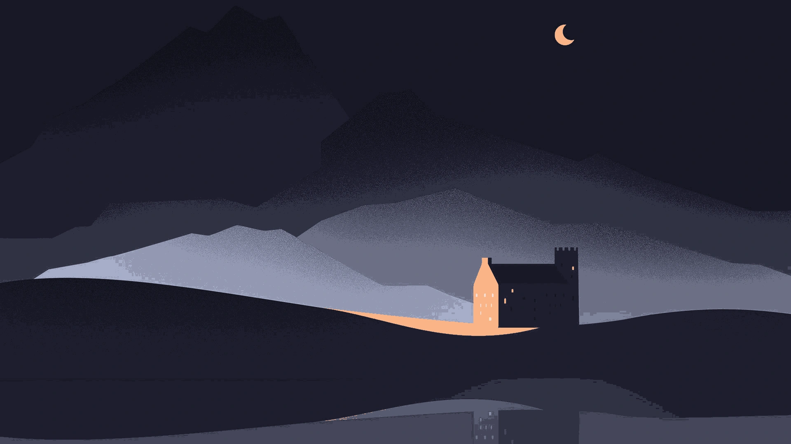
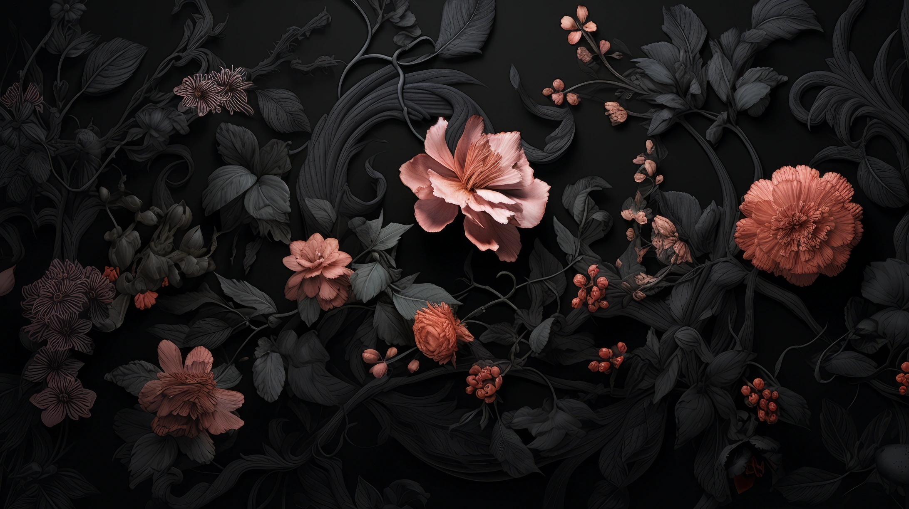
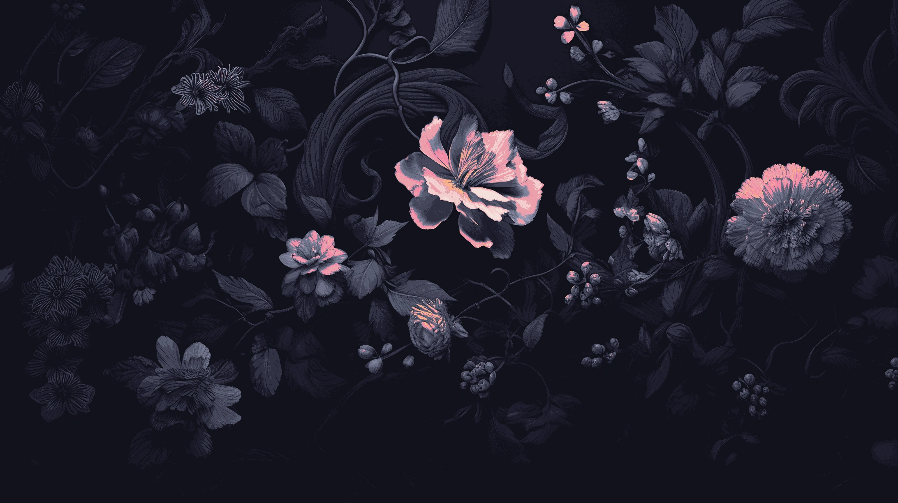
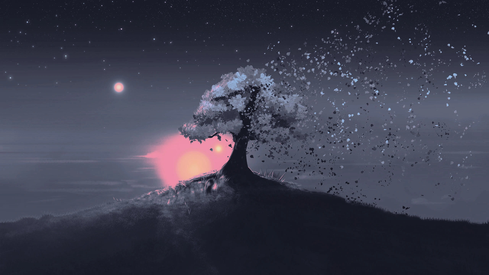

# Walls

<p align="center">
  <a href="https://github.com/anthonyportugal/walls/actions/workflows/ci.yml"></a>
  <a href="https://kernel.org"></a>
  <a href="https://developers.google.com/speed/webp"></a>
  <a href="https://github.com/catppuccin/catppuccin"></a>
  <a href="https://www.gnu.org/software/bash/"></a>
  <a href="LICENSE"></a>
</p>

*Read this in other languages:* [Español](README.es.md)

Curated collection of high-resolution, lightweight wallpapers optimized for minimalist Linux setups, tiling window managers, and the [Catppuccin Mocha](https://github.com/catppuccin/catppuccin) color palette.

> [!TIP]
> Installed and linked by [anthonyportugal/dotfiles](https://github.com/anthonyportugal/dotfiles) with `dotfiles add walls` (both MangoWM and BSPWM sessions).

---

## ✨ Key Highlights

- ⚡ **Pure WebP Storage:** Zero uncompressed PNG/JPG bloat; 50–80% smaller clone size with reduced memory consumption in wallpaper daemons.
- 🛠️ **Collection CLI:** Add, auto-convert and list wallpapers via `bin/walls`; installation is a single `dotfiles add walls`.
- 🎛️ **Dual-WM Compatibility:** Plug-and-play integration with `swaybg` (Wayland / MangoWM) and `feh` (X11 / BSPWM).
- 🖼️ **Automated Gallery:** Instant Markdown preview table generator keeping the README clean, responsive, and up-to-date.

---

## 📦 Installation

walls is a component of the public [dotfiles](https://github.com/anthonyportugal/dotfiles) CLI, which owns its installation and links:

```bash
dotfiles add walls
```

This clones the repository at a pinned commit into `~/.local/share/dotfiles/walls` and creates two links:

- `wallpapers/` → `~/.local/share/wallpapers`
- `bin/walls` → `~/.local/bin/walls`

Health checks, re-synchronization, updates and unlinking are handled by the `dotfiles` CLI as well.

---

## 🛠️ Collection CLI (`bin/walls`)

`bin/walls` is a minimal tool for the collection itself. It resolves its real path, so it works the same through `~/.local/bin/walls`:

```bash
# List all wallpapers with resolution and file size
walls list

# Add a new image (converts to WebP, auto-numbers w-XXX in wallpapers/, refreshes the gallery)
walls add ~/Downloads/wallpaper.png
walls add ~/Downloads/wallpaper.png --name w-010 --quality 90

# Regenerate the gallery below in README.md
walls update-readme

# Show help (also in Spanish with --lang es)
walls help
```

`scripts/optimize.sh [quality]` converts any PNG/JPG left in `wallpapers/` to WebP.

---

## 🚀 Usage with Window Managers

### 1. MangoWM (Wayland)

Wallpapers are automatically managed via `swaybg`:

```bash
swaybg -i ~/.local/share/wallpapers/w-001.webp -m fill
```

*Interactive Selector:* Press `Super + W` or `Super + Ctrl + W` inside the MangoWM session to open the Fuzzel wallpaper picker.

### 2. BSPWM (X11)

Wallpapers are automatically managed via `feh`:

```bash
feh --no-fehbg --bg-fill ~/.local/share/wallpapers/w-001.webp
```

*Interactive Selector:* Press `Super + W` inside the BSPWM session to open the Rofi wallpaper picker.

### 3. Integrated Dotfiles Bootstrap

After bootstrapping the ecosystem via [anthonyportugal/dotfiles](https://github.com/anthonyportugal/dotfiles), add the collection as a component:

```bash
dotfiles add walls
```

---

## ⚡ Formats & Optimization

- **WebP Exclusivity:** Sole image format tracked in this repository. Delivers high visual fidelity with ~50-80% smaller file sizes compared to uncompressed PNGs, leading to near-instant decoding and reduced RAM usage in `swaybg` and `feh`.
- **Zero Duplication:** Original source images (PNG, JPG) are automatically converted upon addition and never committed to Git, preserving a featherweight repository history.

---

## 🎨 Gallery

<details open>
<summary><b>🖼️ Wallpaper Collection (4 available)</b> <i>— Click to collapse / expand</i></summary>
<br>

| `w-001` (1080p) | `w-002` (2K) |
| :---: | :---: |
|  |  |
| `w-003` (2K) | `w-004` (2K QHD) |
|  |  |

</details>

---

## 👤 Author

Architected and maintained by [Anthony Portugal](https://anthonyportugal.github.io).

---

## 📄 License & Attribution

- **Scripts & CLI (`bin/walls`, `scripts/`):** Distributed under the [MIT License](LICENSE) © [Anthony Portugal](https://github.com/anthonyportugal).
- **Wallpapers & Artwork:** Curated and color-adapted for the Catppuccin Mocha aesthetic for personal, non-commercial desktop customization. All copyright and intellectual property rights belong to their respective original artists. If you are the original creator of any wallpaper included here and wish for it to be credited or removed, please open an issue and it will be handled promptly.
